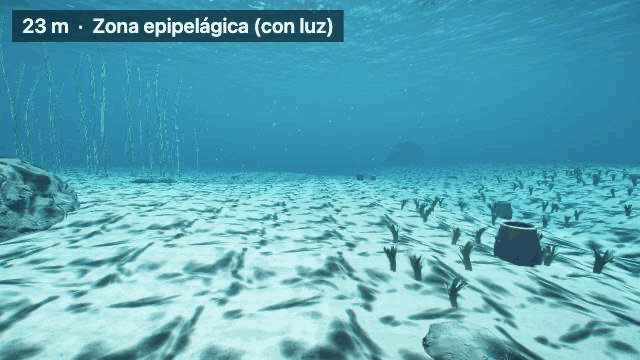

# Hadal

**▶ Probalo en el navegador:** https://kaluka92.github.io/hadal/ (Chrome o Edge con WebGPU)

Descenso 3D navegable de la superficie a ~8.100 m en **un solo archivo HTML** con WebGPU. Sin modelos, texturas ni audio descargados: la geometría, los materiales, la fauna y los cascos de naufragios se generan por código y en la GPU.

> Estado: prototipo. Probado en Chrome de escritorio con una GPU Apple integrada. **No probado** en Safari, Firefox, celular ni GPU dedicadas.

> **English:** Hadal is a navigable 3D dive from the surface to ~8,100 m in a **single HTML file**, written in raw WebGPU/WGSL with no downloaded models, textures or audio. Everything is procedural: GPU-sculpted shipwreck hulls (SDF + surface nets in compute), GPU culling and LOD with indirect draws, temporal anti-aliasing, volumetric lamp beams, autofocus depth of field, ~70 species with sourced depth ranges, and four mythological creatures at the trench floor. Five quality tiers with an automatic performance governor. Written end to end by Claude Sonnet 5.5 (Anthropic) in Claude Code. Try it: https://kaluka92.github.io/hadal/ (Chrome/Edge with WebGPU).

## Uso
Abrí `index.html` en un Chrome o Edge reciente con WebGPU. Necesita internet: Three.js 0.160.0 se carga desde un CDN, solo como biblioteca para armar geometría (el render es WebGPU crudo, sin Three.js). Sin WebGPU, la página lo avisa.

| Tecla | Acción |
|---|---|
| Arrastrar / W A S D | mirar / moverse |
| Espacio · C · Shift | subir · bajar · acelerar (mantené Espacio al llegar arriba para emerger y flotar sobre las olas) |
| F | sónar activo |
| J | diario de campo |
| T | recorrido guiado |
| L | luces: normales / reflectores amplios / apagadas |
| M | sonido |
| G · H | calidad · panel de rendimiento |

## Calidad gráfica
Cinco niveles (menú de inicio o tecla G): **Bajo, Medio, Alto, Ultra, Premium**.

| | Sombras | Fauna y rocas | Detalle lejano | Resolución interna máx. | Extras |
|---|---|---|---|---|---|
| Bajo | — | ×0,95 | 40 m | 85 % | sin MSAA ni TAA |
| Medio | 2048 | ×1,15 | 70 m | hasta 110 % | MSAA ×4, TAA |
| Alto | 3072 | ×1,3 | 100 m | hasta 130 % | TAA |
| Ultra | 6144, 25 muestras | ×2,7 | 160 m | hasta 170 % (tope 4096 px) | TAA, oclusión ambiental (16 muestras), desenfoque de lente (20), luz volumétrica (48 pasos) |
| Premium | 8192, 49 muestras | ×3,4 | 200 m | hasta 210 % (tope 4096 px) | TAA, oclusión ambiental (28 muestras), desenfoque de lente (36), luz volumétrica (64 pasos) |

La resolución interna se ajusta sola. Si Ultra o Premium no sostienen unos ~50 cuadros por segundo, el programa baja un nivel y lo avisa. Ultra y Premium están pensados para GPU dedicadas con 10 GB o más, y **no se probaron en una**.

## Técnicas
- **Cascos esculpidos en la GPU.** Cada barco es un campo de distancia con signo (casco de chapa fina, cubiertas, superestructuras redondeadas, bordes de rotura erosionados con ruido) evaluado en un compute shader y convertido a malla con *surface nets*; el resultado se dibuja con `drawIndirect` sin pasar por la CPU.
- **Culling y niveles de detalle en la GPU.** Cada especie tiene tres bandas de geometría (cercana, media, lejana) elegidas por compute, con instancias indirectas.
- **Reacción de la fauna sin estado.** Los animales huyen o se acercan al submarino calculándolo en el vertex shader a partir de su posición analítica y la de la cámara: no hay buffer de estado ni lectura desde la CPU.
- **Sónar por reconstrucción de profundidad.** Un frente esférico revela superficies reconstruyendo la posición 3D de cada píxel desde el depth buffer, sin geometría extra.
- **Fondo de agua dentro del pase de escena.** La niebla del fondo se dibuja como triángulo a pantalla completa antes del terreno, para que el resolve de MSAA mezcle bien los bordes (hacerlo en el pase final con un test de profundidad dejaba una línea de 1 px en el horizonte).
- **Detalle triplanar con gradientes explícitos y atenuación por profundidad**, y materiales procedurales distintos por tipo de superficie (roca, sedimento, chapa remachada, madera con tablones y agujeros de broma).
- **Bioluminiscencia por compute**: 48.000 partículas excitadas por la estela del submarino.
- **Gobernador de rendimiento** con consultas de marca de tiempo: ajusta resolución y radio de detalle, y baja de nivel de calidad si hace falta.
- **Terreno de alta resolución cerca de la cámara.** Un parche de 251×251 vértices (paso de 25 cm, ±31 m) se recalcula por compute alrededor del submarino y suma, sobre el terreno grueso, rizos de arena, montículos de bioturbación y guijarros procedurales (siempre por encima del terreno grueso, con fundido en el borde, para no necesitar recortes ni costuras). Se activa desde Medio; bit de depuración 32768.
- **Luz volumétrica de los focos.** Marcha de rayos a media resolución en el pase de rayos: dos focos con cono, atenuación por distancia y absorción del agua, fase de dispersión de Henyey-Greenstein, y una densidad de partículas con ruido 3D animado; los pasos se reparten con densidad creciente cerca de la cámara y el haz se corta contra la profundidad de la escena. Desde Medio (el pase viejo de cono queda atenuado). Bit de depuración 65536.
- **Traslucidez de medusas.** Para los materiales translúcidos se suma la luz del foco que atraviesa el cuerpo (más intensa donde la superficie mira a la cámara, teñida por el color propio al cuadrado) y la luz ambiente difusa del agua. Bit de depuración 131072.
- **Profundidad de campo con enfoque automático (Ultra y Premium).** El submarino lee la profundidad del centro de la pantalla con una lectura asíncrona de 1 texel (cada 6 cuadros), suaviza el foco en escala logarítmica y limita el rango a 1,2–20 m; en el pase final se desenfoca con un disco de muestras en espiral áurea (10/18), ponderando por el círculo de confusión de cada muestra para que el fondo desenfocado no manche el primer plano. Bit 262144.
- **Destellos de lente (Ultra y Premium).** Estela anamórfica azulada sobre el bloom y dispersión cromática radial del bloom. Bit 524288.
- **Antialiasing temporal (TAA) desde Medio, y reescalado bicúbico (Catmull-Rom).** Cuando la resolución dinámica baja de 100 %, la imagen se reescala con Catmull-Rom en vez de bilineal y el TAA acumula muestras de subpíxel, así los bordes no quedan en escalera. Jitter de subpíxel (Halton 2,3 de 8 muestras) en la proyección, reproyección del historial con la profundidad y la matriz previa, y recorte por varianza de la vecindad 3×3 para limitar el ghosting en la vegetación que se mueve; el resultado se copia al buffer HDR antes del bloom y del pase final. Interruptor de depuración: bit 16384.
- **Mar de tormenta en la superficie.** Océano de 10 olas de Gerstner (hasta ~10 m de amplitud y 220 m de longitud de onda) calculado en el vertex shader sobre una malla polar centrada en la cámara (~690 mil vértices, con nivel de detalle por distancia y por profundidad), con normales y jacobiano analíticos para la espuma, reflejo de un cielo de tormenta procedural con rayos, brillo del sol, dispersión en las crestas y, desde abajo, ventana de Snell con la forma real de las olas y burbujas. Las mismas olas se evalúan en CPU para que el submarino flote y cabecee. Al emerger aparecen gotas en el vidrio y al sumergirse una ráfaga de burbujas.
- **Piel de la fauna.** Peces con escamas por celdas (relieve por normal derivada, brillo iridiscente según el ángulo de vista y línea lateral); calamares y pulpos con cromatóforos de color variable y iridóforos que centellean. Todo procedural en el fragment shader.
- **Criaturas míticas del fondo de la fosa.** Cuatro figuras de leyenda (Kraken, Leviatán, Escila y Jörmungandr) modeladas por código con barrido de tubos por transporte paralelo del marco, lofts con aletas, cuellos y cabezas de varias hileras de dientes, ojos y fotóforos emisivos. Están marcadas en la ficha como mitos, no como fauna real.
- **Arranque cinematográfico y sonido procedural.** Al sumergirse arranca en la superficie con la tormenta y el título, y desciende solo hasta el kelp (cualquier tecla lo salta). El audio (WebAudio, sin archivos) mezcla viento, oleaje, lluvia y una presión grave que crece con la profundidad, y truenos sincronizados con los rayos del cielo. Nunca se escuchó en una revisión humana.
- **Efectos de impacto**: sacudida de cámara y aberración cromática al tocar el fondo a velocidad.
- **Diario de campo y recorrido guiado**: registra lo que ves, con profundidad y fuente, y se guarda en el navegador.
- **Datos con procedencia**: cada ficha marca ✔ (contrastada con fuentes) o ⚠ (sin confirmar). Es una síntesis didáctica, no una referencia científica.

## Cómo se hizo
Escrito de punta a punta por **Claude Sonnet 5.5** (Anthropic) trabajando en Claude Code, con apoyo puntual de **Claude Opus 5.5** en subtareas acotadas. Las decisiones técnicas, el código y las mediciones los produjo el modelo; una persona fijó los objetivos.

El método de trabajo también es parte de lo que se probó:
- **Medición antes de afirmar**: tiempos de GPU con `await device.queue.onSubmittedWorkDone()`, comparación A/B alternada y ablación capa por capa con una máscara de depuración (`#debug`, `__dbg(mask)`).
- **Bisección visual**: para localizar un defecto se apagan especies una por una y se mide el brillo de píxeles leyendo el canvas desde la página.
- **Interruptores por bit** (`__dbg`) para comparar cada mejora con el comportamiento anterior en el mismo punto de cámara.

## Compilar
`python3 src/build.py` regenera `index.html` a partir de `src/`. Opcional: `node --check src/gpu_check.mjs` valida la sintaxis del módulo.

En `#debug` (`index.html#debug`) quedan funciones de ayuda en `window` (`__go`, `__dbg`, `__sps`, `__st`, entre otras); no afectan al uso normal.

## Límites conocidos
- Representación artística: las especies y el relieve no son un modelo científico exacto.
- Los cascos completos se ven poco por la oscuridad del agua profunda; los reflectores (L) ayudan hasta ~100 m.
- La reacción de la fauna al submarino y el sonido procedural (WebAudio) no se verificaron visualmente ni de oído.
- Sin versión para celular (los controles requieren teclado).
- La carga depende de un CDN sin verificación de integridad.

## Licencia
MIT. Los nombres de naufragios y buques son referencias históricas; el proyecto no usa logos ni imágenes de terceros.
